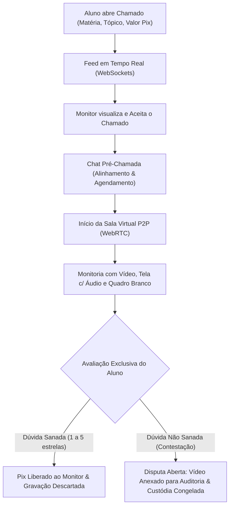

<div align="center">

# 🎓 Hintlink
### *A ponte inteligente entre dúvidas acadêmicas e conhecimento sob demanda.*

[](#-estágio-do-projeto)
[](#-sobre-o-projeto)
[](#-diretriz-operacional-estratégia-web-first)
[](#-ferramentas-e-stack-tecnológica)
[](#-testes-e-qualidade)

</div>

---

## 📌 Sobre o Projeto

O **Hintlink** é uma plataforma universitária de monitorias sob demanda desenvolvida no modelo *peer-to-peer* (estilo Uber). O objetivo central é conectar estudantes universitários que enfrentam dificuldades pontuais em matérias específicas a monitores capacitados (outros estudantes que já cursaram e foram aprovados com excelência naquelas disciplinas), oferecendo atendimento imediato ou agendado, com segurança acadêmica e financeira.

### 🎯 Diretriz Operacional: Estratégia Web-First
O projeto adota uma abordagem **Web-First**, priorizando o desenvolvimento de uma aplicação web responsiva em detrimento de um app nativo inicial:
- **Sem Barreiras de Entrada:** O estudante universitário com dúvida urgente consegue acessar a monitoria diretamente pelo navegador do celular ou computador via link, sem obrigação de baixar um aplicativo.
- **Ecossistema Favorável para Sala Virtual:** Tecnologias essenciais do projeto como **WebRTC** (áudio e vídeo em tempo real), **Web Audio API** (mixagem de som de microfone e tela) e **Canvas interativo** (quadro branco colaborativo) possuem suporte nativo, maduro e de alta performance nos navegadores modernos.
- **Acesso em Rede Local (Multi-Dispositivos):** Servidores configurados para escuta externa (`0.0.0.0` e CORS dinâmico), permitindo testes e uso real simultâneo entre computadores e celulares conectados à mesma rede Wi-Fi.

### 💡 A Proposta de Valor
- **Agilidade e Instantaneidade:** Em vez de esperar pelo horário fixo da monitoria tradicional da faculdade, o aluno pode solicitar ajuda no exato momento em que a dúvida surge.
- **Validação Acadêmica Real (Parser SIGAA):** Monitores só podem lecionar disciplinas em que comprovem aprovação através da importação de seu histórico escolar oficial.
- **Segurança Transacional (Custódia/Escrow):** O pagamento via Pix fica retido pela plataforma e só é liberado para o monitor após o término satisfatório da sessão.
- **Ambiente Imersivo de Aprendizado:** Sala virtual com vídeo, áudio, chat, quadro branco colaborativo e controle de tempo com extensão flexível.
- **Auditoria e Proteção com Pré-Gravação Contínua:** Sessões são gravadas em segundo plano para proteção de ambas as partes. Se a dúvida for sanada, a gravação é descartada; se houver contestação, o vídeo é enviado para a equipe de moderação.

---

## 🚀 Funcionalidades Implementadas



### 👥 1. Autenticação, Perfis e Alternância de Papel
- Cadastro diferenciado com validação de CPF e checagem de e-mail institucional UFABC (`@aluno.ufabc.edu.br`).
- Criptografia de senhas com `bcryptjs` e emissão de tokens JWT com expiração configurável.
- **Alternância Dinâmica de Perfil (Aluno ⇄ Monitor):** O usuário pode trocar entre o modo Aluno e o modo Monitor com um clique na interface sem necessidade de múltiplos cadastros.

### 📄 2. Leitor Inteligente de Histórico Escolar (UFABC SIGAA)
- **Parser de Histórico em PDF:** O monitor faz upload do PDF oficial emitido pelo SIGAA da UFABC.
- O sistema processa o documento via `pdf-parse`, identifica o aluno, o curso, as disciplinas cursadas, os conceitos obtidos (`A`, `B`, `C`, `D`) e o status de aprovação.
- As matérias aprovadas são vinculadas automaticamente ao perfil do monitor no banco de dados, liberando-o para atender solicitações daquelas disciplinas.

### 💬 3. Matchmaking & Chat de Agendamento Pré-Chamada
- **Feed em Tempo Real:** Solicitações de monitoria abertas são transmitidas instantaneamente via WebSockets para os monitores credenciados.
- **Chat Pré-Chamada com Agendamento:** Ao aceitar uma solicitação, o monitor não é jogado diretamente na chamada: abre-se um chat dedicado em tempo real onde monitor e aluno combinam dia, horário e detalhes da aula.
- **Botão de Iniciar Chamada:** Ambos os participantes contam com atalho direto dentro do chat para ingressar na sala virtual quando chegar o momento combinado.

### 🎥 4. Sala Virtual de Monitoria (WebRTC P2P)
- **Streaming P2P de Baixa Latência:** Áudio e vídeo direto entre os participantes via `RTCPeerConnection` nativo com sinalização por WebSockets e servidores STUN do Google.
- **Compartilhamento de Tela Estilo Discord:**
  - Suporte à escolha de **Tela Inteira**, **Janela de Aplicativo Específica** (ex: VS Code, leitor de PDF, terminal) ou **Guia do Navegador**.
  - **Mixagem de Áudio em Tempo Real:** Utiliza a Web Audio API (`AudioContext` + `createMediaStreamDestination`) para mixar o áudio do microfone com o áudio do sistema/aplicativo transmitido, permitindo que o parceiro escute a voz e o som da máquina simultaneamente.
  - Badges visuais indicando status da transmissão e presença de áudio da janela.
- **Quadro Branco Colaborativo com Foco Dinâmico:**
  - Alternância entre **Foco no Vídeo** e **Foco no Quadro Branco**, mantendo **ambos os fluxos montados permanentemente no DOM** (evitando quedas de WebRTC, recargas de áudio ou perda de traços na lousa).
  - Cores temáticas da UFABC, espessuras de traço, borracha, limpeza e download da lousa em PNG.
  - Histórico de traços sincronizado via WebSockets (`ROOM_DRAW`, `ROOM_CLEAR_BOARD`).
- **Chat Integrado na Chamada (`ROOM_CHAT`):** Mensagens instantâneas durante a explicação sem sair da chamada.
- **Controles de Mídia:** Botões para silenciar microfone, desligar câmera, interromper compartilhamento e mutar o som geral da sala.

### 🛡️ 5. Pré-Gravação de Segurança, Avaliação e Ouvidoria
- **Gravação Contínua em Segundo Plano:** Assim que a sala é aberta, um `MediaRecorder` grava o fluxo de conformidade.
- **Fluxo Exclusivo de Finalização pelo Aluno:**
  - O aluno é o único com permissão para acionar a avaliação de encerramento da monitoria.
  - **Se a dúvida foi sanada:** O aluno avalia o atendimento (1 a 5 estrelas) com feedback opcional. A gravação temporária é descartada e o Pix em custódia é liberado para o monitor.
  - **Se a dúvida NÃO foi sanada:** O aluno relata o motivo da insatisfação. O sistema anexa automaticamente o arquivo de vídeo da gravação e gera um Ticket de Disputa (`DisputeTicket`), congelando o repasse e enviando a evidência para auditoria da coordenação.
  - **Fechamento Automático:** Ao concluir a avaliação, um evento `CALL_ENDED_BY_STUDENT` encerra a sala automaticamente para o monitor.

### 🧪 6. Laboratório de Testes de Chamada (Modo Demonstração)
- Disponível diretamente no painel do aluno e do monitor através do botão **"🧪 Testar Chamada"**.
- Permite experimentar toda a experiência da sala virtual (câmera, microfone, medidor VU, quadro branco, compartilhamento de tela com áudio e fluxo de disputa) sem necessidade de um segundo usuário online.

---

## 🛠️ Ferramentas e Stack Tecnológica (100% Open Source)

| Camada | Tecnologia / Ferramenta Open Source | Licença | Finalidade no Projeto |
| :--- | :--- | :--- | :--- |
| **Frontend** | Next.js 14 (App Router) + React 18 + Tailwind CSS | MIT | Interface web responsiva, otimizada para desktop e mobile. |
| **Ícones & UI** | Lucide React | ISC | Conjunto leve e consistente de ícones da interface. |
| **Backend & APIs** | Node.js + Fastify 4 (TypeScript) | MIT | Framework web de alta performance para rotas REST e WebSockets. |
| **Comunicação em Tempo Real** | `@fastify/websocket` (WebSocket nativo) | MIT | Sincronização P2P (ofertas/respostas SDP, candidatos ICE, chat, lousa e status). |
| **Áudio, Vídeo & Tela** | WebRTC Nativo + Web Audio API (`AudioContext`) | W3C / MIT | Conexão P2P criptografada e mixagem de áudio da tela com microfone. |
| **Parser de Documentos** | `pdf-parse` | MIT | Extração e leitura automatizada do histórico escolar oficial do SIGAA UFABC. |
| **Banco de Dados** | PostgreSQL 16 (via Docker) + Prisma ORM 5 | PostgreSQL / Apache 2.0 | Persistência relacional com integridade ACID para usuários, sessões e custódia. |
| **Cache & Presença** | Valkey 7 / Redis OSS (via Docker) | BSD-3-Clause | Gerenciamento de sessões e presença de usuários online. |
| **Segurança & Criptografia** | `bcryptjs` + `@fastify/jwt` | MIT | Hash de senhas e autenticação por tokens stateless. |
| **Testes Automatizados** | Vitest 5 | MIT | Testes unitários e de integração de serviços e parsers. |

---

## 📋 Pré-requisitos e Execução Local

### 1️⃣ Pré-requisitos
- **Node.js LTS** (v20+ ou v24+) instalado.
- **Docker Desktop** instalado e em execução.

### 2️⃣ Inicialização Completa

```bash
# 1. Clone o repositório
git clone https://github.com/GabrYelM/hintlink.git
cd hintlink

# 2. Instale as dependências (raiz, backend e frontend)
npm run install:all

# 3. Suba o banco de dados PostgreSQL e o Redis via Docker
npm run services:up

# 4. Aplique as migrações do banco de dados (no diretório backend)
cd backend
npx prisma migrate dev
cd ..

# 5. Inicie o Back-end e o Front-end juntos no mesmo terminal:
npm run dev
```

O comando unificado `npm run dev` inicializa:
- 🔵 **Back-end:** `http://localhost:3333` (Documentação Swagger em `/docs` e WebSockets em `/ws`)
- 🟢 **Front-end:** `http://localhost:3000`

---

## 🌐 Como Acessar de Outros Computadores (Rede Local / LAN)

O Hintlink foi preparado para permitir testes simultâneos entre múltiplos computadores ou celulares na mesma rede Wi-Fi:

1. **Descubra o endereço IP local da máquina servidora:**
   * No Windows, abra o PowerShell e digite:
     ```powershell
     ipconfig
     ```
   * Localize o **IPv4** do seu adaptador Wi-Fi ou Ethernet (exemplo: `192.168.0.157`).

2. **No outro computador ou smartphone conectado ao mesmo Wi-Fi:**
   * Abra o navegador e acesse:
     ```text
     http://192.168.0.157:3000
     ```
   *(Substitua `192.168.0.157` pelo IP real da sua máquina servidora).*

3. **Dica de Firewall (Windows):**
   * Caso o outro computador não consiga carregar a página, certifique-se de permitir o Node.js no Firewall do Windows ou adicione uma regra para as portas `3000` (Next.js) e `3333` (Fastify).

---

## 🧪 Testes e Qualidade

O projeto conta com suíte de testes automatizados utilizando **Vitest**:

```bash
# Executa todos os testes unitários e de integração
npm test
```

### Cobertura Atual dos Testes:
* `src/modules/requests/requests.spec.ts`: Criação e busca de chamados de monitoria em tempo real.
* `src/modules/sessions/sessions.spec.ts`: Aceite de monitoria, finalização com custódia Pix e abertura de tickets de contestação.
* `src/shared/utils/transcript-parser.spec.ts`: Validação e extração precisa de disciplinas, notas e conceitos do histórico oficial da UFABC.

---

## 🛠️ Scripts Úteis no Workspace

| Comando | Descrição |
| :--- | :--- |
| `npm run dev` | Inicia o Back-end e o Front-end simultaneamente com logs coloridos. |
| `npm run services:up` | Sobe os containers Docker do PostgreSQL e Redis (`docker compose up -d`). |
| `npm run services:down` | Pausa os containers do Docker. |
| `npm run test` | Executa a suíte de testes com Vitest no backend. |
| `npm run build:all` | Compila o backend com `tsup` e o frontend com `next build`. |
| `npm run dev:back` | Executa apenas o servidor Back-end Fastify. |
| `npm run dev:front` | Executa apenas o servidor Front-end Next.js. |

---

## 👥 Equipe do Projeto

Desenvolvido como projeto universitário para a UFABC focado na modernização, segurança e resolução do gargalo de apoio acadêmico e monitoria entre pares.

---

## 📄 Licença

Este projeto está sob a licença [MIT](LICENSE) - consulte o arquivo para detalhes.
