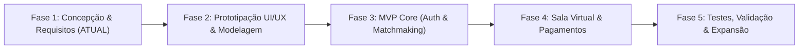

<div align="center">

# 🎓 Hintlink
### *A ponte inteligente entre dúvidas acadêmicas e conhecimento sob demanda.*

[](#-estágio-do-projeto)
[](#-sobre-o-projeto)
[](#-diretriz-operacional-estratégia-web-first)
[](#-ferramentas-e-stack-tecnológica)

</div>

---

## 📌 Sobre o Projeto

O **Hintlink** é uma plataforma universitária de monitorias sob demanda desenvolvida no modelo *peer-to-peer* (estilo Uber). O objetivo central é conectar estudantes universitários que enfrentam dificuldades pontuais em matérias específicas a monitores capacitados (outros estudantes que já cursaram e foram aprovados com excelência naquelas disciplinas), oferecendo atendimento imediato ou agendado, com segurança acadêmica e financeira.

### 🎯 Diretriz Operacional: Estratégia Web-First
O projeto adota uma abordagem **Web-First**, priorizando o desenvolvimento de uma aplicação web responsiva em detrimento de um app nativo inicial, pelos seguintes motivos:
- **Simplicidade e Agilidade:** Reduz a complexidade de configuração de ambientes de desenvolvimento mobile, testes em múltiplos dispositivos e processos de publicação em lojas (Google Play / App Store).
- **Sem Barreiras de Entrada:** O estudante universitário com dúvida urgente consegue acessar a monitoria diretamente pelo navegador do celular ou computador via link, sem obrigação de baixar um aplicativo.
- **Ecossistema Favorável para Sala Virtual:** Tecnologias essenciais do projeto como **WebRTC** (áudio e vídeo em tempo real) e **Canvas interativo** (quadro branco colaborativo) possuem suporte nativo, maduro e de fácil depuração nos navegadores modernos.
- **Evolução Gradual para App:** Como a interface web é concebida de forma totalmente responsiva (adaptada tanto para celulares quanto para computadores), ela pode funcionar como **PWA (Progressive Web App)** e, havendo tempo hábil nas fases finais do semestre, ser portada para mobile (React Native / Capacitor / Flutter).

### 💡 A Proposta de Valor
- **Agilidade e Instantaneidade:** Em vez de esperar pelo horário fixo da monitoria tradicional da faculdade, o aluno pode solicitar ajuda no exato momento em que a dúvida surge.
- **Validação Acadêmica Real:** Monitores só podem lecionar disciplinas que constem com aprovação em seu histórico acadêmico universitário validado.
- **Segurança Transacional (Custódia/Escrow):** O pagamento via Pix fica retido pela plataforma e só é liberado para o monitor após o término satisfatório da sessão.
- **Ambiente Imersivo de Aprendizado:** Sala virtual com vídeo, áudio, chat, quadro branco colaborativo e controle de tempo com extensão flexível.

---

## 📍 Estágio do Projeto

Atualmente, o projeto encontra-se no **Estágio 1: Planejamento, Arquitetura e Engenharia de Requisitos**.



- [x] Levantamento de regras de negócio e proposta de valor.
- [x] Mapeamento inicial de funcionalidades e arquitetura preliminar.
- [ ] Modelagem de banco de dados e diagramas arquiteturais.
- [ ] Wireframes e protótipo interativo no Penpot / Excalidraw.
- [ ] Implementação do Core (Autenticação, Perfis e Catálogo).

---

## 🚀 Estágios do Projeto (Roadmap de Desenvolvimento)

Para garantir previsibilidade e entregas contínuas durante o ciclo universitário, o projeto está estruturado em 5 fases:

### 🔹 Fase 1: Arquitetura & Especificação (Fase Atual)
- Validação das regras de negócio (taxas, mediação de disputas, plantão).
- Definição da stack tecnológica definitiva e infraestrutura de mensageria em tempo real.
- Estruturação do banco de dados (Entidades: Usuário, Matéria, Solicitação, Sessão, Transação, Ticket).

### 🔹 Fase 2: Identidade Visual & Prototipação
- Design System Web responsivo (otimizado para navegadores em desktop, tablets e smartphones).
- Prototipação de telas de solicitação, painel do monitor (plantão) e sala de monitoria interativa.
- Validação de usabilidade com usuários reais da faculdade.

### 🔹 Fase 3: MVP Core (Autenticação, Perfis e Matchmaking)
- Cadastro diferenciado (Aluno e Monitor) com validação de CPF e upload de histórico acadêmico.
- Catálogo de matérias e motor de busca por equivalência de grades.
- Quadro de solicitações abertas em tempo real (WebSockets).

### 🔹 Fase 4: Sala de Monitoria & Transacional
- Integração de vídeo/áudio e quadro branco colaborativo.
- Timer de sessão e sistema de solicitação de extensão de tempo.
- Integração de pagamento via Pix com custódia provisória (escrow) e liberação pós-avaliação.
- Sistema de tickets e mediação de reclamações.

### 🔹 Fase 5: Refinamento & Funcionalidades Avançadas
- Sistema de Ranking dinâmico para monitores.
- Modo Plantão com cálculo dinâmico de participantes.
- *Possibilidade de expansão:* Modo Aulão e solicitação de correção de listas de exercícios.
- Empacotamento em PWA / migração para aplicativo mobile se houver margem no cronograma.

---

## ⚙️ Funcionalidades Mapeadas

### 👥 1. Gestão de Usuários e Segurança
- **Acesso Aluno:** Cadastro com validação de e-mail institucional/pessoal e validação de CPF.
- **Acesso Monitor:**
  - Validação de histórico escolar/universitário (limita as matérias que o monitor está apto a lecionar).
  - Validação de e-mail e CPF.
  - Perfil com estatísticas de atendimento e avaliações.

### 📚 2. Catálogo e Tradução de Matérias
- Cadastro pré-carregado a partir dos históricos validados.
- Tradução de equivalências curriculares entre cursos/grades (Ex: *Bases Matemáticas* ⇄ *Cálculo Diferencial e Integral I*).
- Fluxo para solicitação de inclusão de novas disciplinas ou revisão de equivalências.

### 🎯 3. Solicitação de Monitoria ("Estilo Uber")
- **Visão do Aluno:**
  - Abertura de chamado selecionando matéria, tópico da dúvida, duração estimada e observações.
  - Pagamento antecipado retido em garantia (escrow).
  - Notificação inteligente caso um monitor compatível abra plantão daquela disciplina.
- **Visão do Monitor:**
  - Feed em tempo real de chamados disponíveis com matéria, duração, valor líquido a receber e observações.
  - Aceite de solicitação com início imediato do fluxo da sessão.

### 🚨 4. Modo Plantão
- O monitor ativa o modo online/plantão indicando quais matérias deseja atender no momento.
- Alunos visualizam monitores online e ingressam diretamente no plantão com cobrança proporcional/tabelada.
- Rateio e bonificação calculados conforme volume de participantes e matérias atendidas.

### 💻 5. Sala de Monitoria Virtual
- **Comunicação Multimídia:** Chamada de vídeo e áudio individualizada de baixa latência.
- **Quadro Branco (Whiteboard):** Espaço compartilhado para resolução de cálculos, diagramas e fórmulas em tempo real.
- **Chat de Texto & Anexos:** Troca rápida de links, imagens de enunciados e mensagens.
- **Timer de Sessão:** Contagem regressiva visível para ambos os lados, com mecanismo de extensão de tempo mediante aceite bilateral e cobrança complementar.

### 💳 6. Pagamentos, Avaliação e Ouvidoria
- **Pagamento via Pix:** Geração de QR Code dinâmico; valor mantido em custódia na plataforma.
- **Liberação do Saldo:** Conclusão da monitoria + avaliação do aluno.
- **Sistema de Disputas (Tickets):** Em caso de má conduta ou sessão insatisfatória, o aluno abre um ticket; o repasse ao monitor é congelado e a administração analisa o log da sessão.
- **Ranking & Reputação:** Gamificação baseada no feedback dos alunos para destaque no catálogo e bonificação de taxas da plataforma.

---

## 🛠️ Ferramentas e Stack Tecnológica (100% Open Source)

Em atendimento às diretrizes acadêmicas do projeto, **toda a stack e ferramental adotados são estritamente de código aberto (Open Source)**, sem dependência de plataformas proprietárias ou serviços pagos fechados:

| Camada | Tecnologia / Ferramenta Open Source | Licença | Justificativa |
| :--- | :--- | :--- | :--- |
| **Frontend** | React / Next.js (TypeScript) + Tailwind CSS | MIT | Framework moderno, declarativo e altamente produtivo para interfaces web responsivas. |
| **Backend & APIs** | Node.js (NestJS ou Fastify) | MIT | Ambiente assíncrono de alta performance para I/O com suporte nativo a WebSockets. |
| **Comunicação Real-Time** | Socket.io / WebSockets nativo | MIT | Protocolo bidirecional aberto para atualização de chamados, status de plantão e chat. |
| **Vídeo & Áudio (P2P)** | WebRTC nativo (com PeerJS / Simple-Peer ou Jitsi Meet OSS) | MIT / Apache 2.0 | Transmissão de áudio e vídeo P2P criptografada diretamente no navegador sem custos de infraestrutura proprietária. |
| **Quadro Branco (Whiteboard)** | Excalidraw / Tldraw | MIT / Apache 2.0 | Bibliotecas abertas completas para integração de tela de desenho vetorial colaborativo. |
| **Banco de Dados** | PostgreSQL + Prisma ORM | PostgreSQL / Apache 2.0 | Banco relacional robusto com integridade transacional ACID para pagamentos e históricos. |
| **Cache & Mensageria** | Valkey / Redis OSS | BSD-3-Clause | Gerenciamento ultrarrápido em memória para presença online de monitores e filas de chamados. |
| **Módulo Pix & Custódia** | Biblioteca de Geração EMV Pix (ex: `pix-payload` / `qrcode`) + Motor Interno de Custódia | MIT | Implementação aberta das especificações oficiais do Banco Central para emissão de Pix Copia e Cola/QR Code dinâmico com custódia (escrow) gerenciada internamente. |
| **Design & Prototipação** | Penpot / Excalidraw | MPL-2.0 / MIT | **Penpot** é a principal plataforma livre e web (open-source) para UI/UX design e protótipos de interfaces, eliminando a dependência do Figma. |
| **Planejamento de Tarefas** | Planka / Taiga (ou Git Issues/Projects) | AGPL-3.0 / Apache 2.0 | Gestão visual ágil de tarefas e sprints sem depender de ferramentas fechadas. |

---

## 📋 Pré-requisitos e Execução Local

*(Esta seção será atualizada assim que o repositório receber a base de código do projeto)*

```bash
# Clone este repositório
git clone https://github.com/seu-usuario/hintlink.git

# Acesse o diretório
cd hintlink

# Instruções de instalação e ambiente em breve
```

---

## 👥 Equipe do Projeto

Desenvolvido como projeto universitário para resolução do gargalo de apoio acadêmico e monitoria entre pares.

---

## 📄 Licença

Este projeto está sob a licença [MIT](LICENSE) - consulte o arquivo para detalhes.
